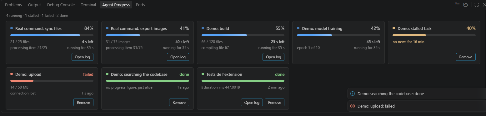

# Agent Progress Bar

When an AI agent starts something long in the background (a build, a big batch of files, model work...), you usually get no sign of life until it is over. This extension gives you one: a progress bar and the time left, in the VS Code status bar, with a panel of progress cards next to the terminal when you click it.

It works with any agent, and with any command or script too: put `agent-progress run` in front of a command, or have a script write a small JSON file. With Claude Code, Codex, GitHub Copilot and Gemini CLI, one click is enough: connect them, and every command they run that lasts shows up on its own. The extension reads the progress folder once a second.



## Install

1. Download the `.vsix` file from the [latest release](https://github.com/LeDeutsch/agent-progress-bar/releases/latest).
2. In VS Code (or Cursor, Windsurf, VSCodium): **Extensions** view, `...` menu at the top, **Install from VSIX...**, then pick the file.

It is not on the VS Code Marketplace yet. To update, install the newer `.vsix` the same way.

From the source: Command Palette, **Developer: Install Extension from Location...**, then pick the folder. `npm run package` builds the `.vsix` (with the official `@vscode/vsce` tool).

## Getting started

Open the **Agent Progress** panel (next to the terminal, or click the status bar). While nothing runs, it shows these buttons:

- **Connect Claude Code** (in Claude's colors), the name of another tool found on your computer, or **Connect an agent** when there are several: see [Connect your agents](#connect-your-agents-their-commands-on-their-own). Once connected, the panel says **Claude Code connected** (or **2 agents connected**) instead; click it for the **Connections** page.
- **Add agent instructions**: adds a short section to the file your AI agent reads, or copies it. The list offers `CLAUDE.md` (Claude Code), `AGENTS.md` (Codex, Copilot, Cursor and most others), `.cursor/rules/agent-progress.mdc` (a Cursor rule applied in every chat), `.github/copilot-instructions.md` (GitHub Copilot), `GEMINI.md` (Gemini CLI) and your global `~/.claude/CLAUDE.md`. It tells the agent to run its long commands through `agent-progress`. Before anything is written, the change shows side by side with your file, and you click **Add** or **Cancel** (in the panel, or the check and cross above the preview; closing the preview cancels); the rest of the file is left as it is, and Ctrl+Z in the editor undoes it. Clicking it again updates the section instead of adding a second one.
- **How it works**: a short guide to show any command or script in the panel, without an AI agent.

## What you see

- In the status bar: `Voice packs 42% · 35 min left`, and `(+1)` when other tasks run too.
- Click it: the **Agent Progress** panel opens next to the terminal (you can drag it to a side bar). The split button at its top puts it **beside the terminal**, both side by side in the bottom panel; clicking it again puts it back in its own tab. One card per task, with the count (`2,440 / 5,808 takes`), the time left, a detail line and how long it has run. Several agents at once each get their own card: running tasks first, then stalled, failed and done.
- When the cards do not fit (beside the terminal, a short panel, many tasks), they turn into rows: one line per task with its name, what it is doing, the percentage, the time left and a thin bar. Hover a row (or reach it with the keyboard) for its buttons and the rest of its story.
- **Open log** on a card opens the log the task writes, scrolled to the latest lines: what the agent is doing right now. **Remove** takes a finished, failed or stalled task off the list.
- The time left follows the speed of the last 3 minutes, so it adjusts when a task speeds up or slows down. Hover it to see where the estimate comes from.
- A task with no news for 10 minutes is shown as stalled (yellow).
- A notification when a task finishes or fails.
- The colors follow your VS Code theme, light, dark or high contrast.

## Try it

In the extension's settings, click **Show demo tasks** (or run **Agent Progress: Show or Hide Demo Tasks** from the Command Palette). Four made-up tasks show in the panel and the status bar for a minute: a build with a count and the time left, a model training with a percentage, a stalled task, and tests that end after 20 seconds with their notification. They live in memory only: nothing is written to the progress folder. Click again to hide them.

From the source folder, `npm run demo` does the same with real progress files for 90 seconds, plus a log, a task with no known progress and a failure.

## The `agent-progress` command

The easiest way to show a task: no JSON to write.

Wrap any command. Its card shows it running, **Open log** shows its output, and it turns done or failed by itself at the end:

```sh
agent-progress run --title "Tests" cargo test --release
agent-progress run --title "Voice packs" --parse --unit takes python make_voices.py
```

Options go before the command; from the command on, everything is passed to it as is (a `--` before the command works too). With `--parse`, the progress is read from the output: the last `12/100`, `12 of 100` or `45%` it prints. The output still shows in the terminal, and the command's exit code is passed on.

Or report progress yourself, one line per update (`set` keeps the fields it is not given):

```sh
agent-progress set build --title "Build" --done 0 --total 120 --unit files
agent-progress set build --done 42
agent-progress done build        # or: agent-progress fail build --detail "disk full"
```

`agent-progress --help` lists everything.

Where it is: the extension writes two small launchers in `~/.agent-progress/bin` at each start (`agent-progress` for bash and zsh, `agent-progress.cmd` for Windows). They run the command with VS Code's own runtime, so Node.js is not needed, and they follow the updates of the extension. That folder is on the PATH of every terminal VS Code opens (open a new one after installing); other programs, AI agents included, call the launcher by its full path, which is what the agent instructions do. To have a plain `agent-progress` everywhere, add `~/.agent-progress/bin` to your PATH, or run `npm link` in the extension's source folder (Node.js needed).

## Reporting progress

Write one JSON file per task in `~/.agent-progress/` (on Windows: `C:\Users\<you>\.agent-progress\`). The file name is the task id: `voice-packs.json`. Rewrite it as the task moves on.

```json
{
  "title": "Voice packs",
  "done": 2440,
  "total": 5808,
  "unit": "takes",
  "detail": "Eva done, Lucas 1,536 / 2,904",
  "started": "2026-11-15T10:12:00Z",
  "state": "running",
  "log": "C:/work/voices/make.log"
}
```

| Field | Needed | Meaning |
|---|---|---|
| `title` | no | What the task is. Default: the file name. |
| `done`, `total` | one of the two ways | Progress as a count. |
| `percent` | one of the two ways | Progress from 0 to 100, if you have no count. |
| `unit` | no | Shown after the count: `takes`, `files`, `tests`. |
| `detail` | no | One line about what is happening right now. |
| `started` | for the time left | When the task started (ISO 8601). Used for the time left until the extension has seen a few minutes of progress. |
| `eta_seconds` | no | Your own estimate of the time left, if you know better. |
| `state` | no | `running` (default), `done`, `failed`, or `ended` (over, without knowing how it went). |
| `log` | no | A log file the task writes, for the **Open log** button. Absolute, `~/...`, or relative to the progress folder. |
| `updated` | no | Last update (ISO 8601). Default: the file's modification time. |
| `heartbeat` | no | `false`: the task says nothing while it runs, so no news does not mean it is stuck. |
| `auto` | no | `true`: found without the task's help (an agent's hook). Shown once it has lasted a while, quick ones never. |

Without `done`/`total` or `percent`, the bar just moves to show the task is alive. Write the file in one go (write to a temporary file, then rename) so it is never read half-written; if it is, the extension keeps the previous value.

When the task ends, set `"state": "done"` (or `"failed"`). A finished task leaves the list after 2 minutes (a line at the bottom of its card empties meanwhile), or right away with **Remove** on its card or **Clear Finished Tasks** (the button at the top of the panel), which delete its file. Progress files with no update for a day are deleted by themselves, with the logs `agent-progress` wrote in the progress folder; logs elsewhere are never touched.

### Examples

Python:

```python
import json, os, time
from pathlib import Path

folder = Path.home() / ".agent-progress"
folder.mkdir(exist_ok=True)
started = time.strftime("%Y-%m-%dT%H:%M:%SZ", time.gmtime())

def report(done, total, state="running"):
    tmp = folder / "my-task.json.tmp"
    tmp.write_text(json.dumps({"title": "My task", "done": done, "total": total,
                               "started": started, "state": state}))
    os.replace(tmp, folder / "my-task.json")
```

Node:

```js
const fs = require("fs"), os = require("os"), path = require("path");
const folder = path.join(os.homedir(), ".agent-progress");
fs.mkdirSync(folder, { recursive: true });
const started = new Date().toISOString();
function report(done, total, state = "running") {
  const file = path.join(folder, "my-task.json");
  fs.writeFileSync(file + ".tmp", JSON.stringify({ title: "My task", done, total, started, state }));
  fs.renameSync(file + ".tmp", file);
}
```

### Telling an AI agent

Click **Add agent instructions** in the empty panel (or **Agent Progress: Add Agent Instructions** in the Command Palette). The section it adds, between `<!-- agent-progress:start -->` and `<!-- agent-progress:end -->`, tells the agent to run its long commands through the launcher, `~/.agent-progress/bin/agent-progress run --title "<what it does>" <command>` (or `agent-progress.cmd` from PowerShell), and to report a script's progress with `set`, `done` and `fail`.

An agent can also write the JSON file itself, as described above.

## Connect your agents: their commands, on their own


Instructions only work when the agent remembers them. With **Claude Code**, **Codex**, **GitHub Copilot** (its CLI and VS Code's agent mode) and **Gemini CLI** you can skip that: connect them, and every command they run that lasts shows up on its own. Connecting adds hooks to the tool's own settings: small calls the tool makes before and after each command it runs. As with the instructions, the change shows side by side first and nothing is written before **Connect**.

The empty panel shows one button, whatever the number of agents: **Connect Claude Code** (or the name of the one tool found), or **Connect an agent** when several are waiting, which opens the **Connections** page. Only the tools on your computer are listed (found by their folder: `~/.claude`, `~/.codex`, `~/.copilot` or VS Code's Copilot extension, `~/.gemini`). The Command Palette has **Agent Progress: Connect an Agent** and **Disconnect an Agent** too.

| Tool | Where the hooks go | Good to know |
|---|---|---|
| Claude Code | `~/.claude/settings.json` | Picked up right away. Background commands end at the end of Claude's turn. |
| Codex | `~/.codex/hooks.json` | Codex asks you to trust a new hook once: run `/hooks` in Codex. |
| GitHub Copilot | `~/.copilot/hooks/agent-progress.json`, a file of the extension's own | Read by Copilot CLI and by VS Code's agent mode (Copilot sessions). Disconnect deletes the file. |
| Gemini CLI | `~/.gemini/settings.json` | Gemini waits for its hooks: about 0.1 s per command. |

From then on:

- A command an agent runs gets a card once it has lasted 20 seconds (`agentProgress.commandsShowAfterSeconds`); quicker ones never show. The title is the description the agent gave the command, or its first line.
- A command in the foreground turns done or failed when it ends, with how long it took or the first line of the error.
- A command in Claude Code's **background** runs until Claude Code no longer lists it at the end of its turn. Claude Code does not say how a background command ended, so its card says **ended** (grey) instead of done or failed. Commands run through `agent-progress run` already have their own card and get no second one.

The hooks only watch: they never change a command, never answer a permission prompt, and always end well (a Copilot hook that failed would deny the command, so each one ends with `exit 0`). Claude Code and Codex do not wait for them (`"async": true`). If the extension is uninstalled, they stay quiet.

Not supported for now: **Cursor** (its hook before a command must answer "allow", which could let a command run without your own approval: a hook that only watches must never do that), **Windsurf** (its hooks moved to Devin, in another format) and **Cline** (its hooks became TypeScript plugins, and did not run on Windows). For them, **Add agent instructions** still works.

The account button at the top of the panel opens the **Connections** page (click it again, or the arrow, to go back to the tasks). One row per tool on your computer: Claude Code's shows the account it is signed in with (its name and the address, masked: `al•••@example.com`); each connected tool shows how many commands it ran today and how many lasted long enough to show, the last one, where its hooks are (click to open the file), and what is left to do in the tool itself. **Disconnect** takes the hooks out, shown side by side first like Connect. A row lays itself out for the room it has: in a narrow panel, one short line with **Show more** for the rest; in a wide one, all the details on one line.

To add Claude Code's hooks by hand (if your settings file has comments, the extension leaves it alone), put this in the `hooks` of `~/.claude/settings.json`, once for each of `PreToolUse`, `PostToolUse`, `PostToolUseFailure` (with `"matcher": "Bash|PowerShell"`) and `Stop`, `SubagentStop`, `SessionEnd` (without a matcher). For the other tools, the extension's own `agent-progress hook codex`, `hook copilot <event>` and `hook gemini` read their events the same way.

```json
{ "matcher": "Bash|PowerShell", "hooks": [{ "type": "command", "command": "\"$HOME/.agent-progress/bin/agent-progress\" hook", "async": true, "timeout": 30 }] }
```

## Settings

Click the gear at the top of the **Agent Progress** panel, or press `Ctrl+,` (`Cmd+,` on macOS) and type `agent progress`. Changes apply right away.

| Setting | Default | |
|---|---|---|
| `agentProgress.folder` | `~/.agent-progress` | Folder watched for progress files. |
| `agentProgress.staleMinutes` | `10` | No update for this long: shown as stalled. |
| `agentProgress.keepFinishedMinutes` | `2` | How long a finished task stays in the list. |
| `agentProgress.deleteFilesAfterHours` | `24` | Progress files with no update for this long are deleted. `0`: never. |
| `agentProgress.notify` | `true` | Notification when a task finishes or fails. |
| `agentProgress.commandsShowAfterSeconds` | `20` | With an agent connected, a command shows once it has lasted this long. |
| `agentProgress.demoSeconds` | `60` | How long the demo tasks stay. Its description holds the **Show demo tasks** link. |

## Privacy

The extension reads the progress folder and the log files the tasks point to. It writes only its two launchers in `~/.agent-progress/bin`, deletes finished task files when you ask it to (and at once the cards of quick agent commands, which never show), edits an agent's instruction file only when you pick it in **Add agent instructions**, and an agent's settings only when you click **Connect** or **Disconnect**. The agents' hook writes one small file per command in the progress folder, with its description and the start of the command line. For the Connections page, it reads the name and address of the account Claude Code is signed in with from Claude Code's own `~/.claude.json`, and shows the address masked; it remembers how many commands each agent ran today, in VS Code's storage for the extension. It never connects to the network and collects nothing.

## License

MIT, see [LICENSE](LICENSE).
